## `▸` [cinammon.net](https://github.com/cinammon-net)

> Plataforma de hosting de servidores de juegos y cloud · [cinammon.net](https://cinammon.net) · [panel](https://panel.cinammon.net) · [docs](https://docs.cinammon.net)

<table>
<tr>
<td width="50%"></td>
<td width="50%"></td>
</tr>
<tr>
<td width="50%"></td>
<td width="50%"></td>
</tr>
</table>

## `▸` [MoxiLab](https://github.com/MoxiLab)

> Moxi, el bot de Discord para comunidades, y su web · [moxilab.me](https://moxilab.me)

<table>
<tr>
<td width="50%"></td>
<td width="50%"></td>
</tr>
</table>

<code>$ ls ~/personal</code> · bots y proyectos propios

 

| repo | qué es |
|---|---|
| [`momojs`](https://github.com/lz20r/momojs) · [`momopy`](https://github.com/lz20r/momopy) | bots de Discord |
| [`totorobot.wa`](https://github.com/lz20r/totorobot.wa) | bot de WhatsApp |
| [`cinnamonScripts`](https://github.com/lz20r/cinnamonScripts) | scripts de Shell para hosting |
| [`NBA`](https://github.com/lz20r/NBA) · [`CEU`](https://github.com/lz20r/CEU) | trabajos de clase |

## `$ discord --status`

## `$ ./trophies --user lz20r`

## `$ ./stats --user lz20r`

## `$ which stack`

<table align="center">
<tr>
<th><code>lenguajes</code></th>
<th><code>frameworks</code></th>
<th><code>bases de datos</code></th>
</tr>
<tr>
<td align="center">

</td>
<td align="center">

</td>
<td align="center">

</td>
</tr>
<tr>
<th><code>devops / os</code></th>
<th><code>herramientas</code></th>
<th><code>diseño / cms</code></th>
</tr>
<tr>
<td align="center">

</td>
<td align="center">

</td>
<td align="center">

</td>
</tr>
<tr>
<th colspan="3"><code>otros</code></th>
</tr>
<tr>
<td align="center" colspan="3">

</td>
</tr>
</table>

## `$ ssh contacto@lz20r`

